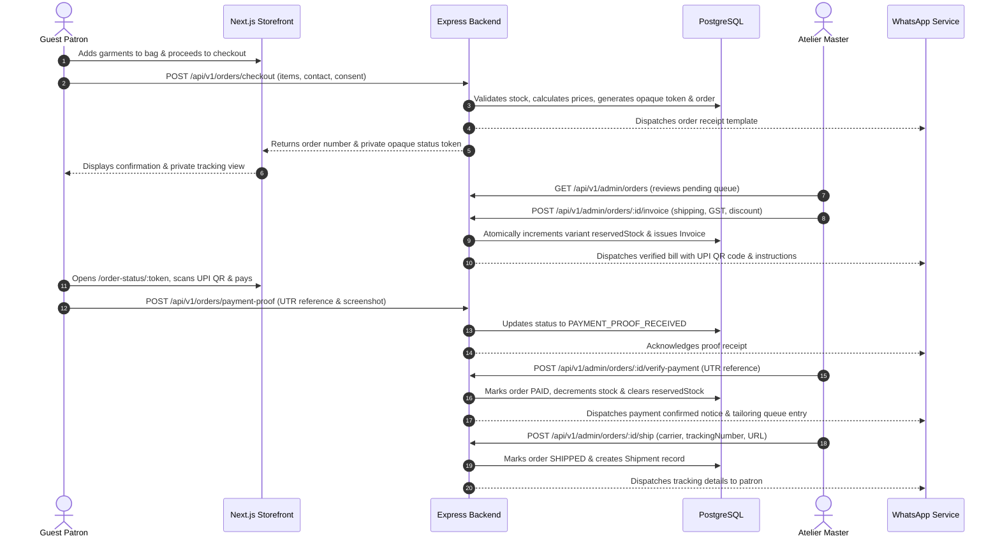

# BHARAT — Luxury Menswear E-Commerce Atelier

An editorial menswear e-commerce platform and atelier operations system engineered with an uncompromising architectural boundary between presentation and commerce authority:

- **Storefront & Admin Experience (`/frontend`)**: Next.js 15 App Router, React 19, TypeScript, Vanilla CSS design tokens with Tailwind CSS utilities, and GSAP 3 animation pipeline.
- **Commerce & Identity Core (`/backend`)**: Express.js, TypeScript, PostgreSQL 16, Prisma ORM, Argon2id password hashing, and stateful server-side session management.
- **Canonical API Contract (`/contracts/openapi.yaml`)**: OpenAPI 3.1 specification.

---

## Architectural Philosophy & Core Tenets

1. **Guest-Only Commerce Model**: There are no customer registrations, passwords, or customer accounts. Patrons transact via guest checkout and track their orders using cryptographically random 32-byte opaque tokens hashed with SHA-256 in the database.
2. **Server-Enforced Commercial Authority**: The frontend owns visual presentation and responsiveness. The Express core is the single source of truth for pricing minor units (paise), inventory availability, stock reservation holds, and state-machine transitions.
3. **Manual Bank Ledger Settlement (QR Payment)**: Patrons scan a verified dynamic UPI QR code or click an app deep link (`upi://pay?...`). Uploading a transaction screenshot transitions the order to `PAYMENT_PROOF_RECEIVED`. **A proof upload alone never marks an order paid.** Staff independently verify the credit in their bank console before marking the order `PAID`, which permanently decrements inventory.
4. **Controlled Administrative Identity**: Public admin registration is permanently disabled. Initial administrator provisioning is performed exclusively via a secure CLI script (`npm run admin:bootstrap --workspace=backend`).
5. **WhatsApp-First Transactional Lifecycle**: Outbound communications (order receipt, verified invoice with payment instructions, proof acknowledgment, payment confirmation, and shipment dispatch with tracking URL) are recorded and dispatched through an audit-logged WhatsApp service.

---

## Monorepo Layout

```text
bk-by-bharat/
├── backend/
│   ├── prisma/
│   │   ├── schema.prisma           # Relational schema (Catalog, Orders, Invoices, Media, WhatsApp)
│   │   └── migrations/             # Timestamped SQL migrations
│   ├── src/
│   │   ├── config/                 # Typed environment & constants
│   │   ├── db/                     # Prisma singleton & idempotent catalog seeder
│   │   ├── middleware/             # Rate limiting, CSRF, auth, RBAC, request correlation
│   │   ├── modules/
│   │   │   ├── admin-auth/         # Argon2id authentication & session rotation
│   │   │   ├── catalog/            # Products, categories, variants, and admin CRUD
│   │   │   ├── commerce/           # Guest checkout, invoicing, QR verification & shipments
│   │   │   ├── media/              # AI Lookbook synthesis & secure uploads
│   │   │   └── whatsapp/           # Outbound dispatch & inbound webhook processing
│   │   ├── routes/                 # Express v1 central router
│   │   ├── app.ts                  # Application assembly & local static /uploads serving
│   │   └── index.ts                # Default Express export for Vercel
│   ├── tests/                      # Vitest test suite (52 integration tests)
│   └── uploads/                    # Local storage for direct and synthesized media
├── frontend/
│   ├── src/
│   │   ├── app/
│   │   │   ├── (store)/            # Storefront routes (PDP, Collections, Checkout, Order Status)
│   │   │   └── admin/              # Operations portal (Catalog, Orders, Proof Review, Settings)
│   │   ├── components/             # Reusable UI & editorial motion components
│   │   ├── context/                # Client CartContext with persistent local bag
│   │   ├── lib/
│   │   │   ├── api/                # Typed API clients (catalog, commerce, media, auth)
│   │   │   └── motion/             # Centralized GSAP 3 configuration & hooks
│   └── next.config.ts              # Reverse proxy rewrite (/api/v1 -> backend)
├── contracts/
│   └── openapi.yaml                # OpenAPI 3.1 specification
└── docker-compose.yml              # Local PostgreSQL 16 container setup
```

---

## Prerequisites

- **Node.js**: v22+ LTS (verified on Node.js v22.14.0)
- **Package Manager**: npm workspaces (v10+)
- **Database**: PostgreSQL 16 (local or Docker container)
- **Container Engine**: Docker Desktop (recommended for local database)

---

## Local Development Setup

### 1. Clone & Install Dependencies

From the repository root:

```bash
npm install
```

### 2. Start PostgreSQL 16 Container

```bash
npm run db:up
# Or: docker compose up -d
```

Verify that the `fashion_commerce_postgres` container is healthy on port `5432`:

```bash
docker ps
```

### 3. Environment Configuration

Create `.env` in `backend/` and `.env.local` in `frontend/`:

**Backend (`backend/.env`)**:
```dotenv
NODE_ENV=<runtime-environment>
PORT=<backend-port>
DATABASE_URL=<postgresql-connection-string>
SESSION_SECRET=<random-secret-at-least-32-characters>
FRONTEND_ORIGIN=<storefront-origin>
TRUST_PROXY=<true-or-false>
```

**Frontend (`frontend/.env.local`)**:
```dotenv
NEXT_PUBLIC_SITE_URL=<public-storefront-url>
API_BASE_URL=<backend-url>/api/v1
```

### 4. Database Schema Migration & Seeding

```bash
# Generate Prisma Client
npm run prisma:generate --workspace=backend

# Apply SQL migrations
npm run prisma:migrate --workspace=backend

# Seed store settings, categories, and 6 published garments with variants
npx tsx src/db/seed.ts --workspace=backend
```

### 5. Bootstrap Initial Administrator

```bash
npm run admin:bootstrap --workspace=backend -- --username=<ADMIN_USERNAME> --password=<SECURE_LOCAL_PASSWORD>
```

---

## Running the Applications

Launch both development servers concurrently:

```bash
# Terminal 1: Backend Express Server (Port 4000)
npm run dev:backend

# Terminal 2: Frontend Next.js Server (Port 3000)
npm run dev:frontend
```

### Application URLs:
- **Editorial Storefront**: [http://localhost:3000](http://localhost:3000)
- **Guest Checkout**: [http://localhost:3000/checkout](http://localhost:3000/checkout)
- **Admin Staff Login**: [http://localhost:3000/admin/login](http://localhost:3000/admin/login)
- **Admin Order Queue**: [http://localhost:3000/admin/orders](http://localhost:3000/admin/orders)
- **Admin Product Catalog**: [http://localhost:3000/admin/products](http://localhost:3000/admin/products)
- **Payment & UPI Settings**: [http://localhost:3000/admin/settings/payment](http://localhost:3000/admin/settings/payment)
- **WhatsApp Audit Logs**: [http://localhost:3000/admin/whatsapp](http://localhost:3000/admin/whatsapp)
- **Backend Health Liveness**: [http://localhost:4000/health/live](http://localhost:4000/health/live)
- **Backend Health Readiness**: [http://localhost:4000/health/ready](http://localhost:4000/health/ready)

---

## Commercial Workflow Walkthrough



---

---

## Milestone Sequence Reconciliation & Audit Status

| Milestone | Intended Scope | Commit / Reference | Status | Verification Detail |
|---|---|---|---|---|
| **M0** | Repository & Service Foundation | `064f2b3` | **PASS** | Monorepo layout, Next.js App Router, Express, PostgreSQL 16, Prisma ORM, Argon2id auth bootstrap. |
| **M1** | Frontend Skeleton & Layouts | `47ed928` | **PASS** | Editorial storefront, collections, PDP, guest checkout, opaque token order view, admin operations shell. |
| **M2** | Motion & Media Presentation | `df4d887` | **PASS** | Centralized GSAP 3 configuration, ScrollSmoother, ScrollTrigger reveals, reduced-motion fallbacks. |
| **M3** | Product Domain & Persistence | `9b294a3` | **PASS** | PostgreSQL catalog schema, Prisma seeder, storefront product queries, currency formatting in paise. |
| **M4** | Express Auth & Admin Product CRUD | `064f2b3` & `9b294a3` | **PASS** | Combined across M0 (Argon2id, session cookies, RBAC) and M3 (admin product CRUD, SKU uniqueness, audit logging). |
| **M5** | AI Media Generation & Uploads | `0eb5626` | **PASS** | Provider abstraction (`ImageGenerationProvider`), studio preset adapter, OpenAI DALL-E 3 adapter, mime validation. |
| **M6** | Guest Commerce, Invoicing & WhatsApp | `3447af3` | **PASS** | Guest checkout, SHA-256 opaque tokens, itemized invoicing, UPI QR settlement, payment proof review, bank verification. |
| **M7** | Hardening, QA & Lifecycle Audit | `762a1a8` & Audit Updates | **PASS** | Paid cancellation, stock restoration, manual refund ledger, Meta webhook signature checks, 52 backend tests verified. |

---

## External Provider Integrations & Operational Reality

To maintain strict truth-in-reporting and avoid fabricated production claims:

### 1. WhatsApp Business Messaging (`backend/src/modules/whatsapp/`)
- **Active Adapter**: `LocalAtelierWhatsAppProvider` (Local Test Adapter).
  - Outbound messages (order receipt, invoice QR instructions, payment proof acknowledgement, payment confirmation, shipment tracking, cancellation decision, and refund notices) are permanently logged and stored in the PostgreSQL `whatsapp_messages` ledger.
  - Interactive commands (`CANCEL <orderNumber>`, `REFUND <orderNumber>`, `STATUS <orderNumber>`) are parsed and routed to commerce services.
- **Production Integration**: `MetaCloudWhatsAppProvider`.
  - To activate live WhatsApp dispatch, provision a Meta Developer App and supply the following variables in `backend/.env`:
    ```dotenv
    META_WHATSAPP_TOKEN=<meta-whatsapp-token>
    META_WHATSAPP_PHONE_ID=<meta-whatsapp-phone-id>
    WHATSAPP_APP_SECRET=<whatsapp-app-secret>
    WHATSAPP_VERIFY_TOKEN=<random-webhook-verification-token>
    ```
  - Production webhook endpoint `POST /api/v1/whatsapp/webhook` requires `X-Hub-Signature-256` HMAC-SHA256 verification with `WHATSAPP_APP_SECRET`; the subscription handshake requires the configured `WHATSAPP_VERIFY_TOKEN`.

### 2. AI Product Photography & Media Generation (`backend/src/modules/media/`)
- **Active Adapter**: `LocalAtelierMediaProvider` (`local_atelier_deterministic_preset`).
  - Generates deterministic, curated luxury studio photography matching the requested garment category and textile specifications.
  - Does **not** run local neural diffusion inference or silently fabricate remote generations.
- **Production Integration**: `OpenAIMediaGenerationProvider`.
  - Implements the server-only `ImageGenerationProvider` interface.
  - To activate live neural image synthesis via OpenAI DALL-E 3 (1024x1024 HD), provide:
    ```dotenv
    OPENAI_API_KEY=<server-side-provider-key>
    ```

---

## Quality Gates & Verification

The following build and test gates were verified on 2026-10-30. Lint and browser/accessibility QA remain outstanding:

### 1. Backend Test Suite (52 Tests)

The integration tests require PostgreSQL and the catalog fixtures. Use only the dedicated local
test database `fashion_commerce_test`; test-mode backend startup rejects non-loopback hosts and
any other database name. Keep `backend/.env.test` local and untracked.

On Windows PowerShell, start the local PostgreSQL service and create the test database once:

```powershell
docker compose up -d postgres
docker exec fashion_commerce_postgres psql -U fashion_user -d fashion_commerce `
  -c "CREATE DATABASE fashion_commerce_test OWNER fashion_user;"
```

Set the process environment from `backend/.env.test` (without displaying its values), then apply
migrations, seed test fixtures, and run tests:

```powershell
Get-Content backend/.env.test | ForEach-Object {
  if ($_ -match '^\s*([^#=\s]+)\s*=\s*(.*?)\s*$') {
    $value = $matches[2].Trim().Trim('"').Trim("'")
    [Environment]::SetEnvironmentVariable($matches[1], $value, 'Process')
  }
}
$env:NODE_ENV = 'test'
npm run prisma:deploy --workspace=backend
npm run db:seed --workspace=backend
npm test --workspace=backend
```

The local test configuration must target `localhost:5432/fashion_commerce_test`. Never point this
workflow at a production or shared database. The test seed is idempotent and restores the catalog
SKUs used by catalog tests.

```bash
npm run test --workspace=backend
```
- `tests/health.test.ts` (3 tests): Liveness, readiness, and database connection checks.
- `tests/admin-auth.test.ts` (9 tests): Argon2id hashing, session cookies, CSRF protection, and revocation.
- `tests/security.test.ts` (4 tests): CSRF double-submit validation and IP rate limiting.
- `tests/catalog.test.ts` (12 tests): Storefront pagination, slug queries, admin drafting, SKU uniqueness, and publishing.
- `tests/media.test.ts` (6 tests): AI Lookbook draft synthesis, file uploads, mime validation, media reordering, and Vercel filesystem guards.
- `tests/commerce.test.ts` (18 tests):
  - Guest checkout with WhatsApp consent validation and opaque token generation.
  - Status retrieval with opaque tokens and rejection of invalid tokens.
  - Admin itemized invoice creation and atomic stock reservation hold.
  - Customer payment proof screenshot and UTR submission (verifying upload never marks paid).
  - Admin independent bank ledger verification, permanent stock decrement, and proof marking.
  - Admin courier shipment dispatch and customer WhatsApp notification.
  - Unpaid order cancellation and reserved stock hold release.
  - Paid order cancellation request, review gating, admin decision, and stock restoration.
  - Manual bank refund recording with UTR reference and duplicate/overage prevention.
  - Meta WhatsApp webhook challenge verification and provider connectivity status reporting.

**Verified 2026-10-30:** Prisma migrations were applied to the dedicated local PostgreSQL 16 test
database, the catalog test seed was applied, and all 52 backend integration tests passed (6 test
files). Workspace typechecks and production builds also passed. Lint and browser/accessibility QA
were not run as part of this verification.

### 2. Typechecking Across Workspaces
```bash
npm run typecheck --workspaces
```
- Frontend: `tsc --noEmit` — 0 errors.
- Backend: `tsc --noEmit` — 0 errors.

### 3. Production Bundles
```bash
npm run build --workspaces
```
- Frontend Next.js 15: All 12 routes compiled as optimized production static/dynamic targets in 7.9s.
- Backend: TypeScript production compilation via `tsc` succeeded with 0 errors.

---

## Vercel Deployment Preparation

The repository is an npm-workspaces monorepo with a root `package-lock.json`. Use **two Vercel
projects connected to the same Git repository**; do not flatten, copy, or rename the workspaces.
Vercel's current [monorepo guidance](https://vercel.com/docs/monorepos) supports a separate project
for each workspace.

### Storefront project

- **Root Directory:** `frontend`
- **Framework:** Next.js (automatic detection)
- **Build Command:** `npm run build`
- **Output Directory:** leave the Next.js default
- **Runtime:** choose Node.js 22 in Vercel Project Settings
- Set `API_BASE_URL` to the backend project's HTTPS URL followed by `/api/v1`. The Next.js rewrite
  sends browser `/api/v1/*` traffic to that backend; server-side API calls use the same setting.

### API project

- **Root Directory:** `backend`
- **Framework:** Express (automatic detection)
- **Entry point:** [`backend/src/index.ts`](./backend/src/index.ts) default-exports the Express
  application; the existing [`backend/src/server.ts`](./backend/src/server.ts) remains the local
  development/startup listener.
- **Build Command:** `npm run prisma:generate && npm run build`
- **Output Directory:** leave unset; Vercel creates the Express Function.
- **Runtime:** choose Node.js 22. Apply database migrations through a controlled release/migration
  step, not during every build.
- The API remains mounted under `/api/v1`. Vercel's Express integration routes requests through the
  app without a separate experimental Services configuration.

The frontend API calls use a same-origin rewrite, which keeps the admin cookie on the storefront
origin. The API's production CORS allow-list is the configured `FRONTEND_ORIGIN`; set it to the
exact storefront origin. Production session cookies are Secure and `__Host-` prefixed. If calling
the API directly from another origin, configure that exact origin and verify cookie behavior in a
preview deployment.

### Vercel environment variables

Set production and preview values in **Vercel Project Settings → Environment Variables**. Do not
commit them, paste credentials into source, or put private values in `NEXT_PUBLIC_*` variables.
Use separate database credentials and secrets for preview and production.

| Variable | Application | Required | Visibility | Needed |
|---|---|---:|---|---|
| `DATABASE_URL` | Backend | Yes | Secret | Build for Prisma generation; runtime for PostgreSQL |
| `SESSION_SECRET` | Backend | Yes (32+ chars) | Secret | Runtime |
| `FRONTEND_ORIGIN` | Backend | Yes | Public origin, not credential | Runtime CORS and origin checks |
| `TRUST_PROXY` | Backend | Yes in production (`true`) | Non-secret | Runtime |
| `NODE_ENV` | Backend | Set by Vercel | Non-secret | Runtime |
| `PORT` | Backend | No; local server only | Non-secret | Local runtime; Vercel manages the function listener |
| `API_BASE_URL` | Frontend | Yes | Server-side URL, not credential | Build for rewrites and runtime server-side requests |
| `NEXT_PUBLIC_SITE_URL` | Frontend | Optional; currently unused by application code | Public | Build/runtime only if future public URL features use it |
| `META_WHATSAPP_TOKEN` | Backend | Optional; required for live Meta dispatch | Secret | Runtime |
| `META_WHATSAPP_PHONE_ID` | Backend | Optional; required with the Meta token | Not a credential, treat as server config | Runtime |
| `WHATSAPP_APP_SECRET` | Backend | Required to accept signed Meta webhooks in production | Secret | Runtime |
| `WHATSAPP_VERIFY_TOKEN` | Backend | Required for Meta webhook verification | Secret | Runtime |
| `OPENAI_API_KEY` | Backend | Optional; required for OpenAI image generation | Secret | Runtime |

`POSTGRES_USER`, `POSTGRES_PASSWORD`, and `POSTGRES_DB` are used by the separate Docker Compose
deployment, not by the Vercel projects. Compose production credentials no longer have embedded
fallback secrets; supply them through a private deployment environment.

### Production storage blocker — do not deploy commerce uploads yet

The current upload and payment-proof implementation writes to `backend/uploads` on local disk.
Vercel Express Functions do not persist writable application files between invocations, and
`express.static()` does not serve assets on Vercel. The Vercel runtime now skips local static
serving and returns an explicit `503` for local-disk image-generation/file-upload and payment-proof
flows rather than reporting ephemeral writes as durable.

Before enabling production checkout/payment proof review, implement and verify an external
persistent object-storage adapter: product images can use durable public/CDN URLs, while payment
proofs must use a private bucket with authorized retrieval (or short-lived signed URLs after the
existing guest/admin authorization). Do not make proof objects publicly readable. Vercel Function
request/response bodies are limited to **4.5 MB**, and the current Express JSON parser is limited to
1 MB; the existing 10 MB base64 upload path is not a suitable production upload path. Prefer
authenticated direct-to-object-storage uploads with size/content validation.

No `.vercelignore` or `vercel.json` is required for this arrangement; omitting custom routing avoids
excluding shared workspace files or conflicting with framework routing. The backend entrypoint is
prepared, but no Vercel deployment or live preview has been performed.

References: [Express on Vercel](https://vercel.com/docs/frameworks/backend/express),
[Vercel Function limits](https://vercel.com/docs/functions/limitations), and
[Vercel monorepos](https://vercel.com/docs/monorepos).

---

## Security Hardening Details

- **CSRF Defense**: State-changing requests enforce matching origin/referer headers and double-submit CSRF cookie validation (`X-CSRF-Token`).
- **Rate Limiting**: IP-based rate limiting on sensitive authentication and commerce routes (`express-rate-limit`).
- **Security Headers**: Standard security headers enforced via `helmet`.
- **Upload Restrictions**: Max 10MB limit and whitelist validation for `image/jpeg`, `image/png`, `image/webp`, and `image/avif`.
- **Authoritative Accounting**: All prices in minor units (paise); integer calculations prevent floating point discrepancies.
- **Opaque Token Privacy**: Database stores only SHA-256 hashes of private status tokens, preventing IDOR or sequential enumeration attacks.
- **Webhook Authenticity**: Meta WhatsApp webhook HMAC-SHA256 signature verification (`X-Hub-Signature-256`) and challenge handshake.

---

## License

Private Proprietary Software — Bharat Atelier New Delhi. All rights reserved.
